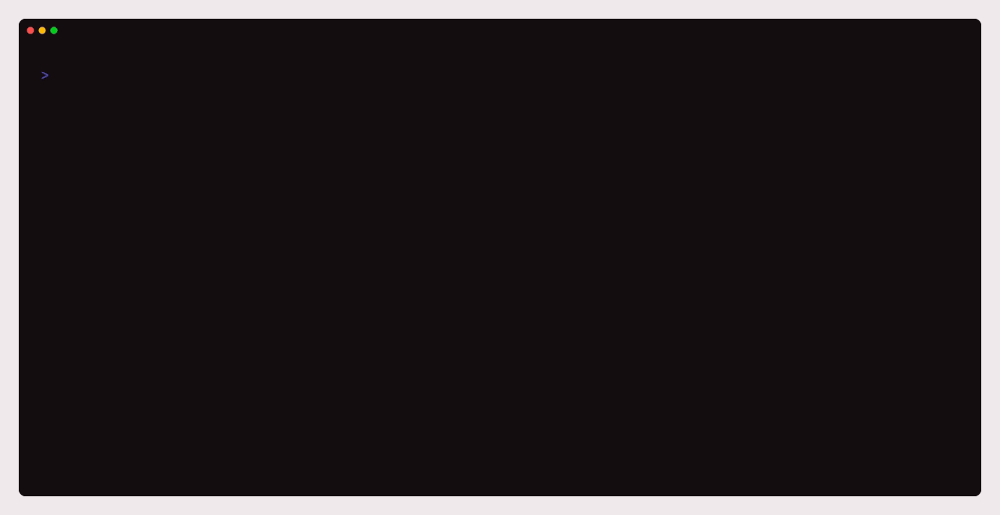

<p align="center"></p>

> A developer's switchyard: point local apps at any backend stand, keep servers and secrets at hand, build and deploy - from any directory.

<p align="center">
  <a href="https://crates.io/crates/turnout"></a>
  <a href="https://www.npmjs.com/package/turnout-cli"></a>
  <a href="https://github.com/lacodda/turnout/actions"></a>
  <a href="https://github.com/lacodda/turnout/blob/main/LICENSE"></a>
</p>

## Why

Working against several backend stands scatters the day: you `cd` into a folder to start a project, edit `.env` files across repositories to switch a stand, dig through notes for a password, and keep deploy paths in your head.

turnout keeps all of it in one place and works from any directory. What it is, on one screen: [lacodda.github.io/turnout/what-is-turnout](https://lacodda.github.io/turnout/what-is-turnout/).

## A day in the life

<p align="center"></p>

Point an app at a stand - the app keeps talking to `localhost`, and the [gateway](https://lacodda.github.io/turnout/concepts/gateway/) routes it there, with a cookie jar per app **and** stand so the switch does not log you out:

```console
$ turnout use web staging
'web' now uses 'staging'.
The running gateway picks this up automatically.
'staging' is up: https://staging.example.com/health answered 200 in 84 ms.
```

Start working, from wherever you happen to be. The console stays quiet once the server is up - until something breaks:

```console
$ cd ~/dev/web/src/components
$ turnout dev --open
[web] pnpm dev --port 5100
[web] http://web.localhost -> dev server port 5100
◇  web ready in 1.4s - http://web.localhost
```

Ship it - build, back up, upload as one archive, restart, and ask the stand whether it works:

```console
$ turnout deploy web-prod-eu -b
[web] pnpm build
✓ Connected to deploy@prod-eu.example.com:22
✓ Backup 20260809-011500.tar.gz created in /var/www/web.backups
Uploaded 142 files (3.11 MiB) to prod-eu:/var/www/web
✓ Restarted: systemctl restart web
✓ Healthy: GET https://prod-eu.example.com/health - 200 in 38 ms
Deploy of 'web' to 'prod-eu' finished.
```

And see what has been going on:

```console
$ turnout status
turnout 1.1.0  ~/.local/share/lacodda/turnout

Apps
  api  -> staging  http://api.localhost  spare :7101 (TURNOUT_GATEWAY_URL)
  web  -> prod-eu  http://web.localhost  spare :7100 (VITE_API_URL)

Gateway  running · pid 24180 · up 2h 05m
  ! 'staging' answers 502 - the stand is down, not the app (3m)

Jobs  2 running - `turnout ps` shows the rest

Recent
   3m ago  deploy  web -> prod-eu (142 files)
```

## What you get

- **A dev gateway.** One address per app (`http://web.localhost`), ports assigned for you, redirects and WebSockets proxied, a session per app and stand. [Gateway](https://lacodda.github.io/turnout/concepts/gateway/)
- **Servers, logins and paths, apart** - joined into named targets, so `turnout deploy web-prod` works from any directory. [Entities](https://lacodda.github.io/turnout/concepts/entities/)
- **A deploy that checks itself.** `--diff` before, a health check after and a rollback when it fails, a history of every deploy; Linux and Windows servers alike. [deploy](https://lacodda.github.io/turnout/reference/deploy/)
- **Access set up, not just used.** Secrets in the OS keyring, `key setup` that proves a key before switching to it, the SSH agent, and every server's host key checked. [SSH access](https://lacodda.github.io/turnout/guides/ssh-access/)
- **Tunnels to what a stand keeps private.** `turnout tunnel db@staging 5432` puts the stand's database at `localhost:5432`, in the background, back by itself after a dropped connection. [tunnel](https://lacodda.github.io/turnout/reference/tunnel/)
- **A quiet console and jobs in the background.** A loader instead of scrollback, the output on the spot when something fails, `--detach` with a desktop notification at the end. [Quiet console](https://lacodda.github.io/turnout/concepts/quiet-console/)
- **A doctor.** `turnout doctor` says why it does not work, and `doctor --server prod` where a deploy would stop - each with its fix. [doctor](https://lacodda.github.io/turnout/reference/doctor/)
- **One window onto it all.** `status`, `status --short` for a prompt line, `--json` on every command that reports, an action journal of every change.
- **Portable settings.** `export` and `import` between machines, secrets sealed with a passphrase; a file from any release since 0.11 still imports.

The whole tour is on [the documentation site](https://lacodda.github.io/turnout/).

## Install

```bash
brew install lacodda/tap/turnout                                    # macOS, Linux
scoop bucket add lacodda https://github.com/lacodda/scoop-bucket    # Windows
scoop install turnout
npm i -g turnout-cli                                                # anywhere with Node
cargo install turnout                                               # from source
```

Or the one-line installers - PowerShell on Windows, `sh` on macOS and Linux:

```powershell
irm https://raw.githubusercontent.com/lacodda/turnout/main/tools/install.ps1 | iex
```

```bash
curl -fsSL https://raw.githubusercontent.com/lacodda/turnout/main/tools/install.sh | sh
```

Every way but `cargo install` also sets up the short alias `tn`. Archives for Windows x86_64, Linux x86_64 and arm64, and macOS arm64 are on [the releases page](https://github.com/lacodda/turnout/releases/latest); what each installer reads is in [Getting started](https://lacodda.github.io/turnout/getting-started/).

## Quick start

```bash
turnout setup                  # first-run wizard: creates the data directory
turnout app add                # register a project (a wizard over every field)
turnout server add             # register a stand
turnout use                    # bind one to the other
turnout gateway start          # route traffic through the gateway
turnout deploy-setup           # to deploy: walks the credential, path and target
```

## Status

v1.1.0, on the 1.x line - the first stable one. The settings are a contract: an export written by any release since v0.11 imports into this one, and nothing in 1.x breaks it. Deploys are proven against real Linux and Windows servers on every push; what landed in each version is in [the changelog](https://github.com/lacodda/turnout/blob/main/CHANGELOG.md).

## Documentation

Commands, concepts and guides: **[lacodda.github.io/turnout](https://lacodda.github.io/turnout/)**. The site's source is in [`docs/`](https://github.com/lacodda/turnout/tree/main/docs), and architecture decision records are in [`docs/adr/`](https://github.com/lacodda/turnout/tree/main/docs/adr).

## License

MIT (c) [Kirill Lakhtachev](https://lacodda.com)
